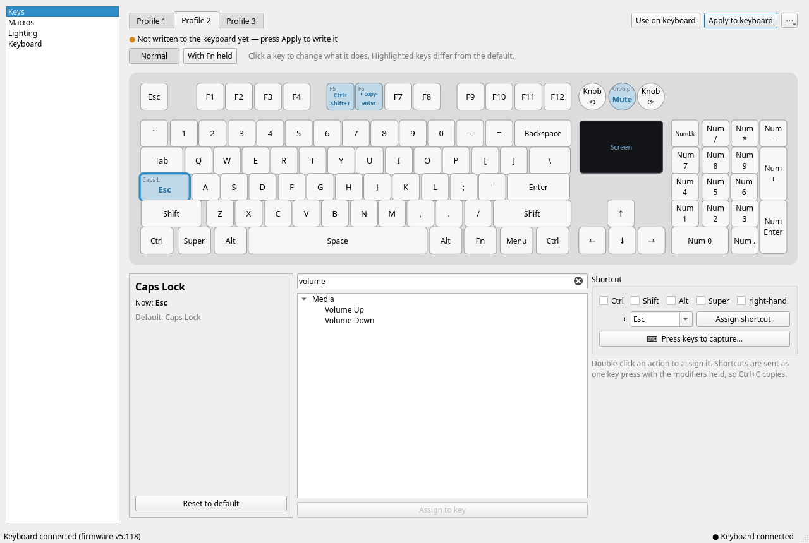
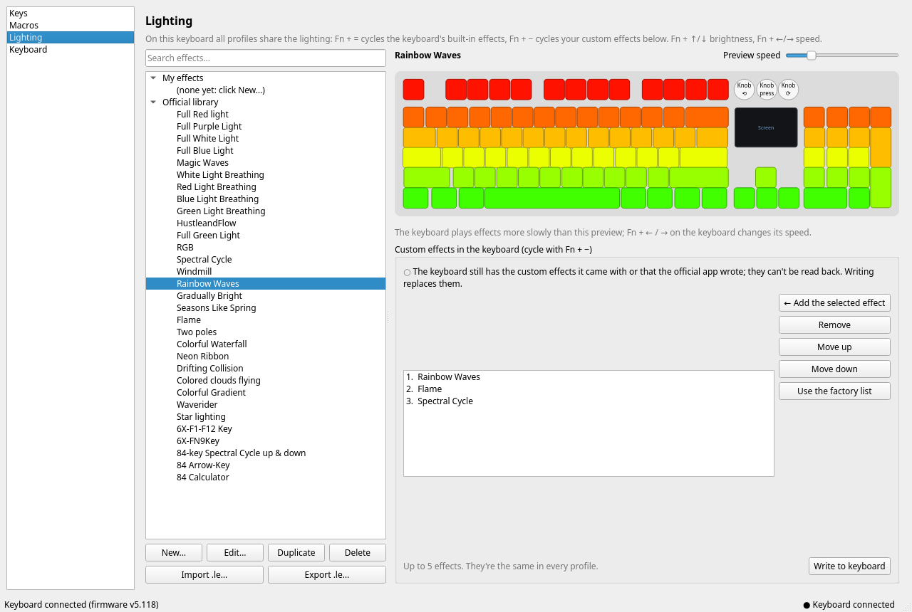

# OpenGK6X

An open-source Linux app for **GK6X keyboards**, made for the **Skyloong GK104 Pro**: remap keys, set up the Fn
layer, record macros and design lighting effects, without the official Windows software. Everything is stored in the
keyboard, so it keeps working with no software running, on any computer, over the cable, the 2.4 GHz receiver or
Bluetooth.



## What it can do

- **Your own layout everywhere**: the **Standard** profile (the keyboard's own layout) is editable too — something
  the official app can't do — and it's the one the keyboard uses over **2.4 GHz and Bluetooth**.
- **Three more profiles** (profile 1–3, used on the USB cable). For each key, normal and with **Fn held**, pick
  anything the official app offers:
  - any key or **shortcut** (Ctrl+Shift+T, Super+D, …), or press the shortcut to capture it
  - media keys, browser keys, calculator, mouse buttons, sleep
  - lighting controls (brightness, effect speed, on/off)
  - **switch profile** keys
- **Knobs** (the GK104 Pro has three): each knob shows what turning it left, turning it right and pressing it do;
  click a knob to set its three actions separately (normal and with Fn), with the usual knob actions suggested
  first (volume, media, brightness, zoom, tabs, …).
  - **macros**, run N times, while held, or until pressed again
- **Macros**: record what you type (with the pauses), or build them step by step (key press/release/tap, waits,
  mouse clicks); a compact text form (`+ctrl c -ctrl 100ms enter`) for quick edits.
- **Lighting**: the official effect library with a live animated preview, your own effects (one color, paint the
  keys, breathing, color cycle, rainbow wave in any direction, sweeping band), and the **custom effects list** the
  keyboard cycles with **Fn + −**.
- **Live mode** (while OpenGK6X runs, also from the tray): lighting effects at full speed, **typing effects**
  (pressed keys glow, or a ripple spreads from each key), and **key actions** only the PC can do: run a command,
  open a URL or folder, type a text snippet, play a macro of any length. Optionally starts at login.
- **Import and export**: profiles (`.gpr`/`.cmf`), macros (`.cms`) and effects (`.le`) from and for the official app,
  or its whole data folder; plus one-file OpenGK6X backups.
- A command line (`opengk6x`) for all of it.

Better than the original: the keyboard picture is your keyboard (the GK104 Pro's **knobs** and its screen are drawn
where they are), every profile starts from the layout printed on the keys (the official app's
defaults for profiles 2 and 3 are a Mac layout and "Backspace = Delete"; the Mac layout is offered as a starting
point instead), **macros work on the Fn layer** (in the official app they only run if also on a normal key, and then
always the first macro), and writing a profile **keeps the lighting effect you picked** (the official app resets it).



## Supported keyboards

OpenGK6X reads each keyboard model's layout, defaults and features from the official app's data, so it works with
the keyboards the official GK6X app supports (Skyloong / Epomaker GK6X family: GK61, GK64, GK68, GK75, GK84, GK87,
GK96, GK980, SK21, SK61, SK87, SK96, GK104 Pro and more, 275 models in GK6X 8.0.7), connected with the USB cable
(USB ID `1ea7:0907`). It adapts to each model: profiles with their own lighting where the keyboard has them,
no Fn layer or live mode where the model has none.

It's been tested on the **GK104 Pro**. On other models the basics come from the same official data and code paths,
but hardware variants (knobs, screens, split spacebars: Keyboard page → *Physical layout*) and firmware quirks may
differ. Reports and fixes are welcome.

## Install

**Arch / CachyOS, system-wide** (recommended; `makepkg -si` installs the dependencies, builds the latest version
from GitHub and installs the app, the command, the device access rule and the app-menu entry):

```bash
sudo pacman -S --needed git base-devel
git clone https://github.com/AbdulWasayWk/OpenGK6X.git
cd OpenGK6X/packaging && makepkg -si
```

**For your user only, from a checkout** (no package; puts `opengk6x` and `opengk6x-gui` in `~/.local/bin` and
adds the app-menu entry, all running the code in the checkout):

```bash
sudo pacman -S --needed git python-hidapi pyside6 7zip
git clone https://github.com/AbdulWasayWk/OpenGK6X.git
cd OpenGK6X && tools/install-user.sh
```

The user install doesn't add the device access rule (that needs root). Add it once (it grants your user the
keyboard's configuration interface only, not the keys you type; OpenRGB's rules also cover the wired keyboard):

```bash
tools/setup-dev.sh udev
```

Use one of the two, not both (to switch from the user install to the package, run `tools/install-user.sh --remove`
first).

**Then, once: the keyboard data.** The layout and defaults of each keyboard model, and the lighting effect
library, come from the official app (they belong to its maker, so they aren't included). Download
*GK6X_Setup_8.0.7.zip* from Epomaker's [Skyloong driver page](https://epomaker.com/blogs/software/skyloong-driver)
(Windows software), then:

```bash
opengk6x setup-data ~/Downloads/GK6X_Setup_8.0.7.zip
```

It copies only that data into `~/.local/share/opengk6x/vendor`; nothing from the official app runs. (With the user
install you can also pass the zip to the installer: `tools/install-user.sh ~/Downloads/GK6X_Setup_8.0.7.zip`.)
Then plug the keyboard in with its USB cable (replug it if it was connected) and open **OpenGK6X** from the app menu.

**Updating:** package: run `makepkg -si` again in `OpenGK6X/packaging`. User install: `git pull` in the checkout.
Then restart OpenGK6X (if live mode keeps it in the tray, quit it from the tray icon first).

## Uninstall

The keyboard keeps what's written to it either way, and works without the app.

**Package:**

```bash
sudo pacman -Rns opengk6x-git
```

If you turned on *Start OpenGK6X in the tray when I log in* (Live mode page), also delete
`~/.config/autostart/opengk6x-live.desktop`.

**User install** (from the checkout; then you can delete the `OpenGK6X` folder):

```bash
tools/install-user.sh --remove
sudo rm /etc/udev/rules.d/70-opengk6x.rules      # if you added the device access rule
```

**Your settings stay** so a reinstall picks them up. To remove them too (this deletes your profiles, macros and
effects): `~/.config/opengk6x/`, `~/.local/state/opengk6x/` and the keyboard data `~/.local/share/opengk6x/`. To
clear the keyboard itself, hold **Fn + Esc + Q** (factory reset).

## Using it

Connect the keyboard **with its USB cable** (settings are written over the cable; afterwards they work over every
connection). Open **OpenGK6X** from the app menu.

- **Keys**: choose profile 1, 2 or 3. A profile OpenGK6X hasn't written yet is marked *not set up*: the keyboard
  may still hold settings from the official app, which keyboards can't send back. Start from the standard layout
  (or the Mac layout), click a key, choose what it does, and press **Apply to keyboard**. The keyboard switches to
  that profile; **Use on keyboard** switches to it without writing. The standard profile is the keyboard's own
  layout and isn't changed.
- **Macros**: **New**, then **Record…** or add steps. Assign macros to keys on the Keys page. After editing a macro,
  apply the profiles that use it (the Keys page shows them as changed).
- **Lighting**: click effects to preview them; **New…** opens the effect editor. Add up to five effects to the
  custom list and press **Write to keyboard**. The first time, this replaces the custom effects the keyboard came
  with or the official app wrote. On the keyboard: **Fn + =** built-in effects, **Fn + −** your custom effects,
  **Fn + ↑/↓** brightness, **Fn + ←/→** speed. The keyboard plays effects more slowly than the preview.
- **Live mode**: pick an effect, a typing effect and key actions, then **Start live mode**. Closing the window
  keeps it running in the tray; quitting, or applying/switching a profile, ends it and puts the keyboard back on
  the profile you chose.
- **Keyboard**: connection and firmware, switching profiles, backups, official app files, the keyboard's own
  shortcuts.

**If something goes wrong**: switch back to the standard profile (Keyboard page, or `opengk6x mode standard`), or
hold **Fn + Esc + Q** to reset the keyboard to factory settings (then use "I reset the keyboard" on the Keyboard
page, and apply your profiles again).

### Command line

```
opengk6x info                                   # model and firmware
opengk6x keys | actions [search]                # key names | what keys can do
opengk6x bind 2 "Caps Lock" esc                 # change a key (saved, then written); --fn for the Fn layer
opengk6x bind 2 F5 macro:greet --repeat while_held
opengk6x bind standard knob2-left previous_track # knobs (left to right): knob1-left, knob1-right, knob1-press, …
opengk6x unbind 2 "Caps Lock" | profile list | profile show 2 | profile apply 2 | profile reset 2
opengk6x macro set greet "+shift h -shift i 50ms enter" | macro list | macro delete greet
opengk6x effects [search] | lighting show | lighting set "Rainbow Waves" Flame | lighting apply
opengk6x mode standard|1|2|3                    # switch the keyboard's profile
opengk6x live run                               # live mode with the Live page's settings (Ctrl+C ends it)
opengk6x export backup.json | import backup.json
opengk6x import ~/old-windows/GK6XPlus-CMS      # the official app's data folder (or .gpr/.cmf/.cms/.le files)
opengk6x export --official folder/              # files the official app can import
```

## Where things are

- `~/.config/opengk6x/` — your profiles (`<model>/profiles.json`), custom effects list (`<model>/lighting.json`),
  macros (`macros.json`), effects (`effects/`). These are the only record of what's in the keyboard.
- `~/.local/state/opengk6x/` — logs of what was last written.
- `~/.local/share/opengk6x/vendor/` — the official app's keyboard data (`setup-data`).

## Limits

- Settings can only be written over the USB cable (the official app has the same limit).
- Over 2.4 GHz and Bluetooth the GK104 Pro uses only the Standard profile, and the keyboard doesn't accept macros or
  Fn-layer changes there: put key remaps in Standard to have them everywhere; macros and the Fn layer work in
  profiles 1–3 on the cable.
- On the GK104 Pro, profiles 1–3 don't have their own lighting; the keyboard's effect choice (Fn + = / −) is shared.
- The official app's "Space, long press" functions do nothing on the GK104 Pro, so OpenGK6X doesn't offer them there.
- Physical layout: Keyboard page → *Physical layout* (the GK104 Pro by default; a full-size 104-key option for other
  keyboards of the same model).
- The keyboard can't report what's stored in it.

## Development

```
python3 -m unittest discover -s tests -t .      # 35+ tests; no keyboard needed
python3 -m opengk6x.gui                         # run from the checkout
```

`docs/PROTOCOL.md` documents the USB protocol and data formats, `CLAUDE.md` the project's findings and decisions.
The profile writer reproduces the official app byte for byte: `tools/re/golden_profile.js` runs the app's own code
against a fake keyboard, and `tests/golden/` holds its output for the test profiles. Prior art:
[pixeltris/GK6X](https://github.com/pixeltris/GK6X) and OpenRGB's Skyloong GK104 Pro driver.

## License

GPL-3.0-or-later. Not affiliated with Skyloong, Epomaker or the makers of the GK6X software.
